# HƯỚNG DẪN CHI TIẾT TẠO FILE ISO WINPE CỨU HỘ MÁY TÍNH CHUYÊN NGHIỆP TỪ A ĐẾN Z

> **Mục tiêu tài liệu:** Hướng dẫn từng bước cách tự build một file ISO WinPE cứu hộ máy tính đa năng (dựa trên nền tảng **PhoenixPE / PEBakery** và **Windows 11 23H2**). Bản WinPE này hỗ trợ đầy đủ chuẩn khởi động UEFI - Legacy (MBR), tích hợp sẵn trình điều khiển Intel RST nhận diện mọi ổ cứng SSD NVMe đời mới, kết nối mạng LAN / Wi-Fi, giao diện Explorer thân thiện cùng bộ công cụ cứu hộ dữ liệu, phá mật khẩu và phân chia ổ đĩa mạnh mẽ.

---

## 📋 MỤC LỤC

1. [Chuẩn bị công cụ & Bộ cài Windows](#1-chuẩn-bị-công-cụ--bộ-cài-windows)
2. [Tải và giải nén bộ công cụ PhoenixPE](#2-tải-và-giải-nén-bộ-công-cụ-phoenixpe)
3. [Tải và Gắn (Mount) file ISO Windows 11 nguồn](#3-tải-và-gắn-mount-file-iso-windows-11-nguồn)
4. [Khởi chạy PEBakery và thiết lập Source Config](#4-khởi-chạy-pebakery-và-thiết-lập-source-config)
5. [Cấu hình hệ thống Lõi (Core Config)](#5-cấu-hình-hệ-thống-lõi-core-config)
6. [Cấu hình Giao diện người dùng (Shell & StartAllBack)](#6-cấu-hình-giao-diện-người-dùng-shell--startallback)
7. [Tích hợp các thành phần hệ thống & Tinh chỉnh (Components & Tweaks)](#7-tích-hợp-các-thành-phần-hệ-thống--tinh-chỉnh-components--tweaks)
8. [Tích hợp Ứng dụng cứu hộ chuyên dụng (Applications)](#8-tích-hợp-ứng-dụng-cứu-hộ-chuyên-dụng-applications)
9. [Tích hợp Trình điều khiển phần cứng (Drivers)](#9-tích-hợp-trình-điều-khiển-phần-cứng-drivers)
10. [Cấu hình hoàn tất và Thiết lập xuất file ISO (Finalize & Media Creation)](#10-cấu-hình-hoàn-tất-và-thiết-lập-xuất-file-iso-finalize--media-creation)
11. [Tiến trình Đóng gói (Build) và Nhận thành phẩm](#11-tiến-trình-đóng-gói-build-và-nhận-thành-phẩm)
12. [Hướng dẫn tạo USB Boot từ file ISO vừa tạo](#12-hướng-dẫn-tạo-usb-boot-từ-file-iso-vừa-tạo)

---

## 1. Chuẩn bị công cụ & Bộ cài Windows

Trước khi bắt đầu, hãy chuẩn bị:
- **Máy tính:** Đang chạy Windows 10 hoặc Windows 11 (khuyến nghị nền 64-bit).
- **Dung lượng ổ đĩa trống:** Tối thiểu **15 GB - 20 GB** trên ổ đĩa làm việc để tải, giải nén và đóng gói file ISO.
- **Kết nối Internet ổn định:** Để tải các gói phụ thuộc và cập nhật script nếu cần.

---

## 2. Tải và giải nén bộ công cụ PhoenixPE

### Bước 1: Truy cập trang lưu trữ PhoenixPE trên GitHub
Mở trình duyệt web của bạn và truy cập vào địa chỉ chính thức của dự án PhoenixPE:
👉 **[https://github.com/PhoenixPE/PhoenixPE](https://github.com/PhoenixPE/PhoenixPE)**

Trường hợp nếu dự án bị khóa hoặc tạm bảo trì các bạn có thể truy cập dự án mình đã clone
👉 **[https://github.com/lethetuan/PhoenixPE](https://github.com/lethetuan/PhoenixPE)**

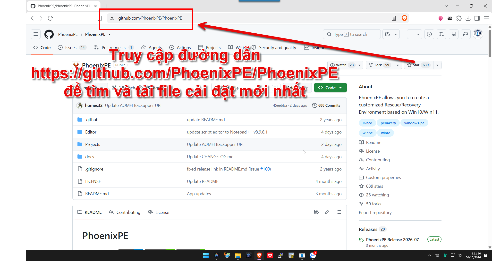

---

### Bước 2: Xem tài liệu và cuộn xuống khu vực tải về
Tại giao diện trang chủ GitHub của PhoenixPE, cuộn xuống phần tài liệu giới thiệu **README.md** để tìm đường dẫn tới mục tải bản phát hành mới nhất.

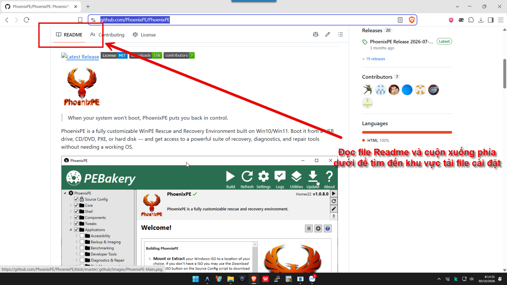

---

### Bước 3: Nhấp vào liên kết tải phiên bản mới nhất
Trong phần **Getting Started**, tại dòng số 1 (`1. Download the latest release and unpack it...`), nhấp vào liên kết xanh **`latest release`**.

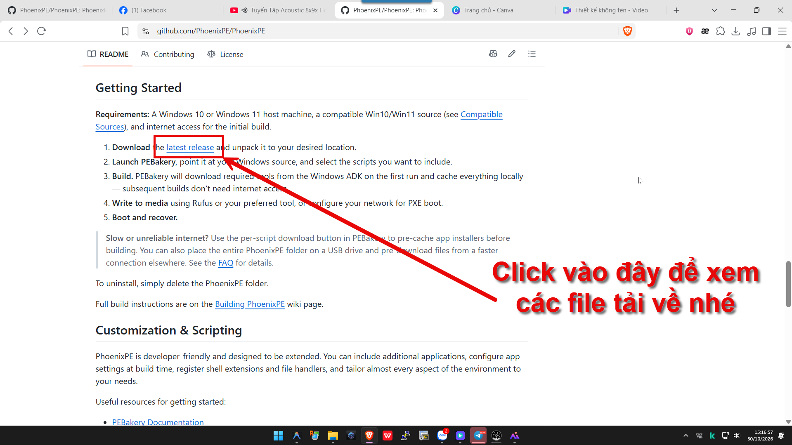

---

### Bước 4: Chọn bản phát hành mới nhất
Trang **Releases** sẽ liệt kê các phiên bản theo mốc thời gian. Bạn nhấp vào phiên bản mới nhất ở trên cùng danh sách (ví dụ: `PhoenixPE Release 2026-10-25` hoặc bản cập nhật gần nhất).

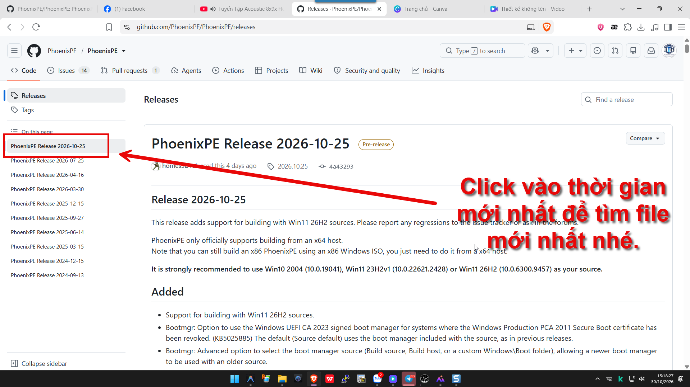

---

### Bước 5: Tải tập tin nén của PhoenixPE
Tại mục **Assets** của bản phát hành đó:
- Nhấp tải về tập tin có định dạng `.7z` (ví dụ: **`PhoenixPE-2026.10.25-x64.7z`** - dung lượng khoảng 260 MB).
- Đây là gói độc lập đã tích hợp sẵn môi trường chạy .NET và trình soạn thảo kịch bản.

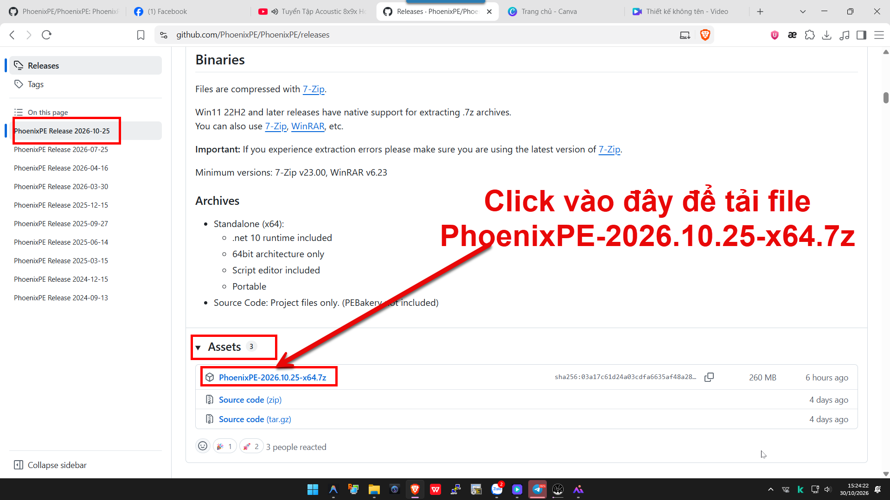

---

### Bước 6: Giải nén tập tin PhoenixPE
Sau khi tải xong, mở thư mục chứa file nén:
- Nhấp chuột phải vào file **`PhoenixPE-2026.10.25-x64.7z`** và chọn **Extract All...** (hoặc dùng 7-Zip / WinRAR để giải nén).
- Giải nén ra một thư mục riêng biệt (ví dụ: `D:\Desktop\PhoenixPE-2026.10.25-x64`).

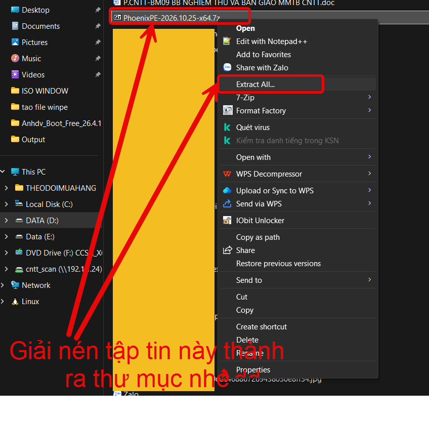

---

## 3. Tải và Gắn (Mount) file ISO Windows 11 nguồn

PhoenixPE cần một bộ cài Windows chính gốc để bóc tách các tệp hệ điều hành, môi trường WinPE cơ bản và nạp thư viện hệ thống.

### Bước 7: Tải file ISO Windows 11 23H2 (64-bit)
Truy cập trang lưu trữ (Archive.org hoặc trang chủ Microsoft) để tải bản ISO Windows 11 tương thích tốt nhất với PhoenixPE:
- Khuyến nghị sử dụng bản **Windows 11 23H2 (build 22631.4751)** bản x64 tiếng Anh (`clientmulti` hoặc `Enterprise`).
- Nhấp chọn tải định dạng **ISO IMAGE**.

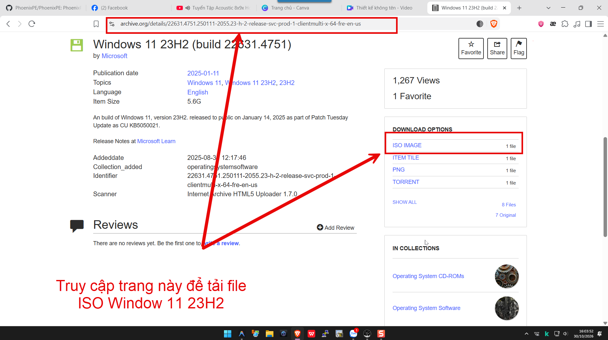

---

### Bước 8: Mount file ISO thành ổ đĩa ảo
Sau khi tải xong file ISO Windows 11:
1. Mở File Explorer và tìm đến file ISO vừa tải: `Windows 11 23H2 (build 22631.4751).ISO`.
2. Nhấp chuột phải vào file ISO và chọn dòng lệnh **Mount** (Gắn ổ đĩa ảo).
3. Windows sẽ tự động tạo một ổ đĩa DVD ảo (trong hình là ổ **`DVD Drive (F:)`**). Bạn cần nhớ ký tự ổ này để trỏ đường dẫn ở các bước sau.

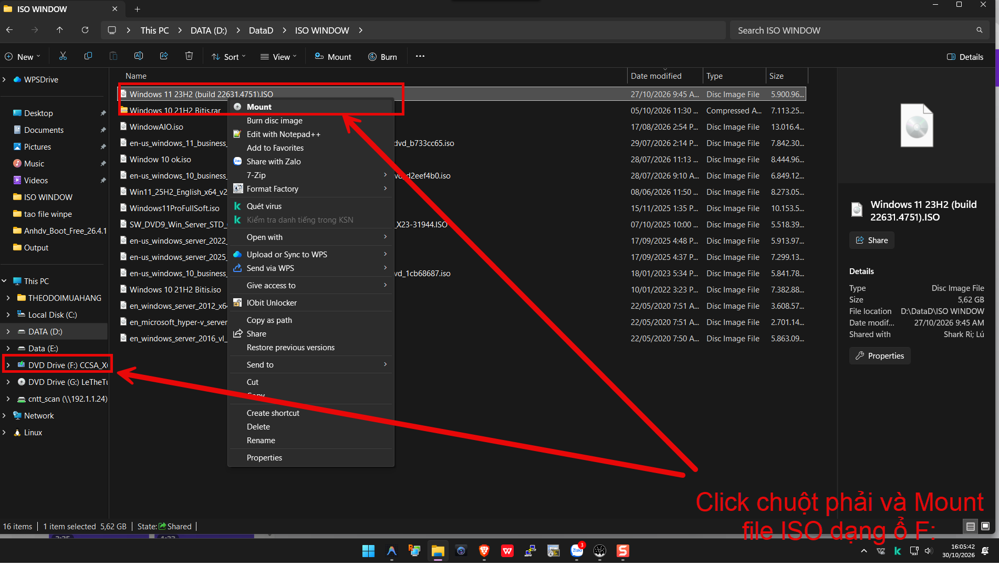

---

## 4. Khởi chạy PEBakery và thiết lập Source Config

### Bước 9: Mở PEBakeryLauncher với quyền Administrator
1. Mở thư mục PhoenixPE đã giải nén ở Bước 6.
2. Tìm tập tin **`PEBakeryLauncher.exe`**.
3. Nhấp chuột phải vào file và chọn **Run as administrator** (*Bắt buộc chạy quyền Quản trị viên để phần mềm có đủ quyền mount WIM và can thiệp Registry*).

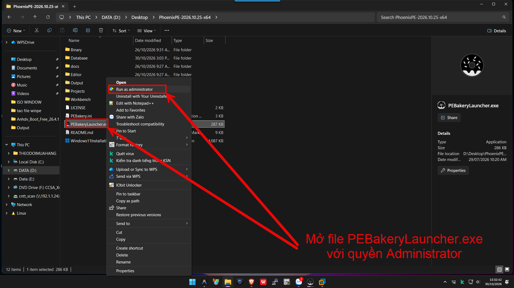

---

### Bước 10: Vào giao diện cấu hình PhoenixPE
Khi cửa sổ công cụ **PEBakery** mở ra:
- Trên cây điều hướng phía bên trái, nhấp vào biểu tượng bánh răng **`PhoenixPE`** ở góc trên cùng để chuyển sang chế độ thiết lập dự án.

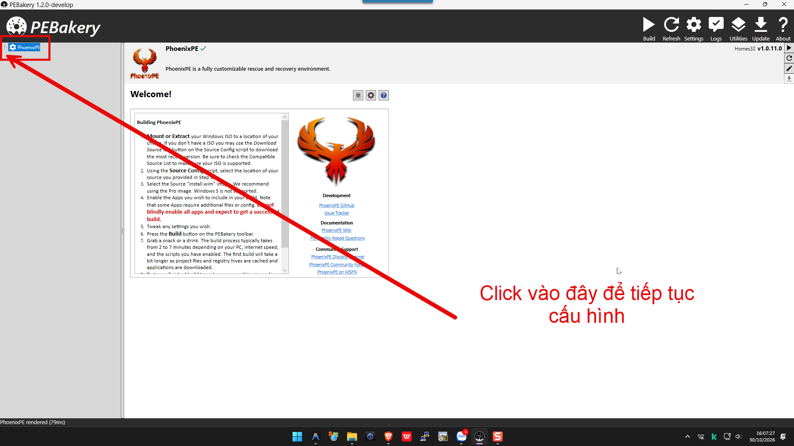

---

### Bước 11: Bắt đầu cấu hình Source Config
Nhấp chọn mục **`Source Config`** ở đầu danh sách để khai báo nguồn dữ liệu Windows ISO.

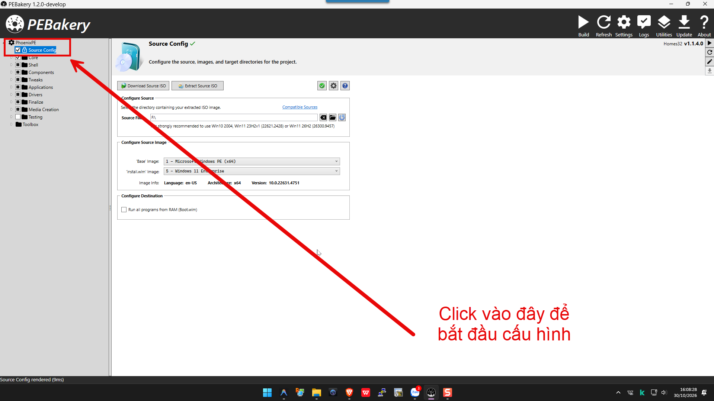

---

### Bước 12: Duyệt đến ổ đĩa vừa Mount
Tại khung **Configure Source**:
- Dòng **Source Files:**, nhấp vào biểu tượng chiếc thư mục màu vàng bên cạnh ô nhập để mở hộp thoại duyệt tìm đường dẫn.

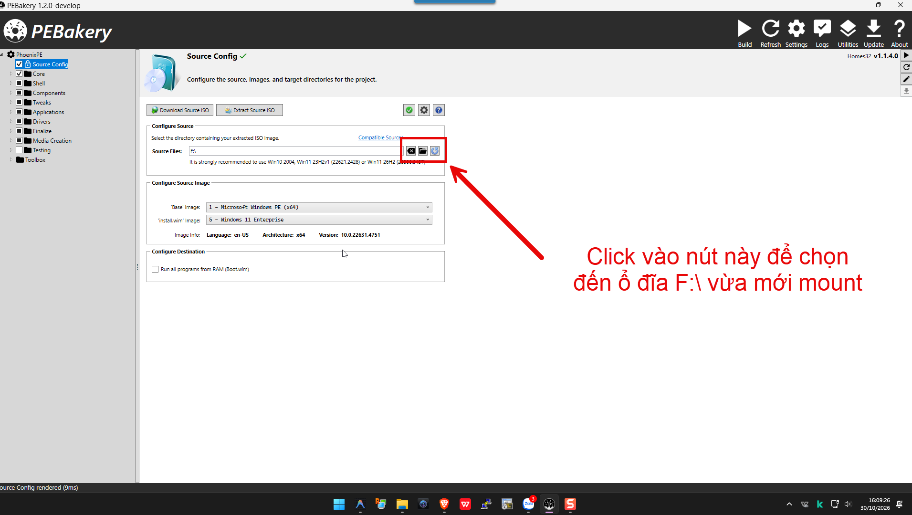

---

### Bước 13: Chọn thư mục gốc của ổ ảo F:\
Trong cửa sổ chọn thư mục:
1. Nhấp chọn ổ đĩa DVD ảo đã mount ở Bước 8 (ví dụ: `DVD Drive (F:) CCSA_X64FRE_EN-US_DV9`).
2. Nhấn nút **Select Folder**.

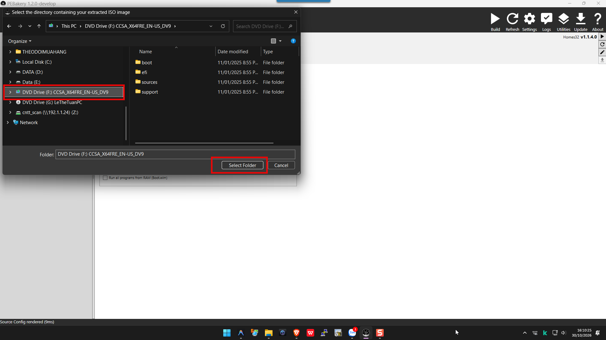

---

### Bước 14: Đợi PEBakery quét và đọc dữ liệu nguồn
- Chương trình sẽ tự động kiểm tra tính tương thích của bộ cài.
- Nếu xuất hiện thông báo cảnh báo `Source Config - Warning: You have selected a source with [Install.esd] present...`, bạn cứ bấm **OK**.
- Chờ vài giây để chương trình nạp xong thông tin các phân vùng WIM/ESD từ đĩa nguồn.

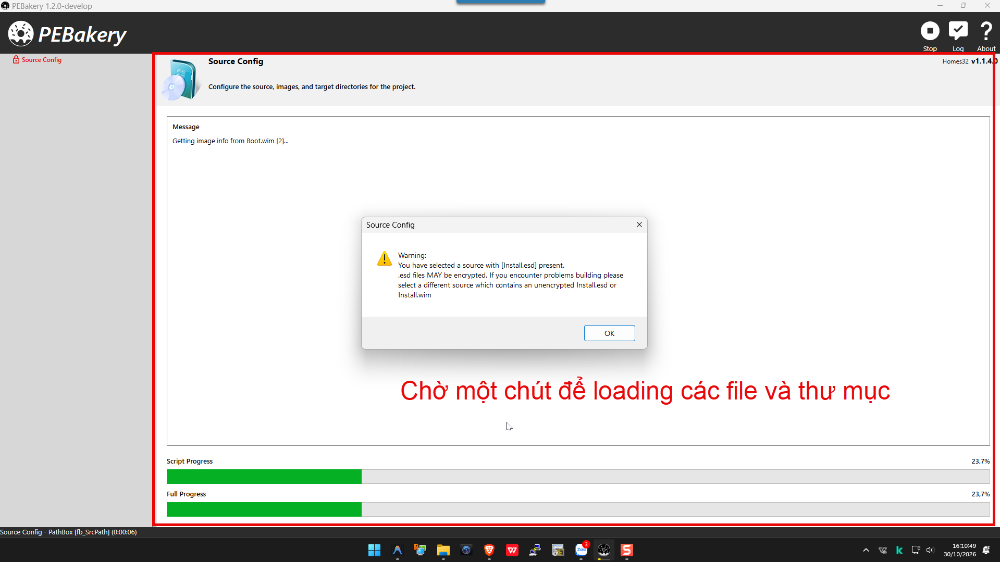

---

### Bước 15: Chọn 'Base' Image
Tại khung **Configure Source Image**:
- Ô **'Base' Image**: Nhấp vào menu thả xuống và chọn **`1 - Microsoft Windows PE (x64)`**.

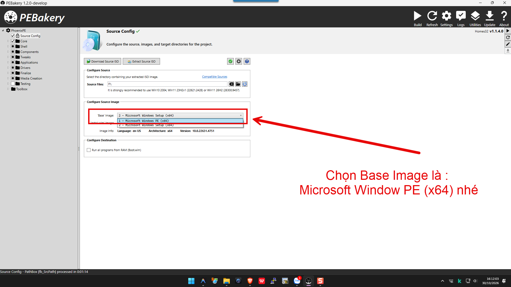

---

### Bước 16: Chọn phiên bản 'install.wim' Image làm nền tảng
- Ô **'install.wim' Image**: Nhấp menu thả xuống và chọn **`5 - Windows 11 Enterprise`** (Phiên bản Enterprise chứa đầy đủ nhất các gói thành phần hệ thống để làm nền tảng cho WinPE).

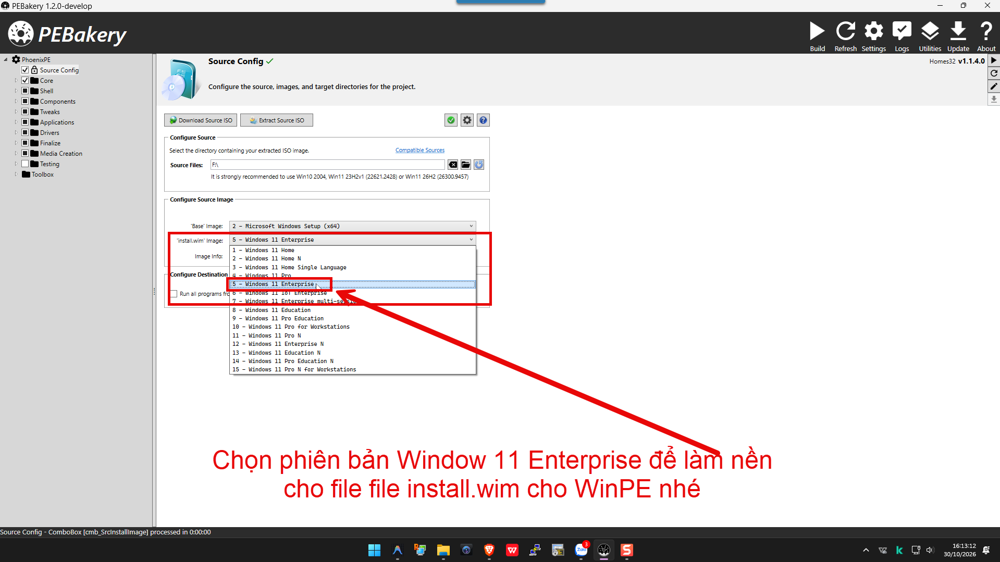

---

## 5. Cấu hình hệ thống Lõi (Core Config)

### Bước 17: Tích chọn các thành phần Core thiết yếu
Nhấp vào mũi tên bên cạnh mục **Core** trên cây thư mục bên trái để mở rộng danh sách. Hãy đảm bảo tích chọn toàn bộ các mục có biểu tượng ổ khóa cốt lõi:
- ☑ **Pre-Flight Check:** Kiểm tra tính toàn vẹn và môi trường trước khi build.
- ☑ **Core Files:** Các file nhị phân và dịch vụ cốt lõi của WinPE.
- ☑ **Core Registry:** Cơ sở dữ liệu Registry trung tâm.
- ☑ **Core Config:** Tùy biến thông số lõi.
- ☑ **Core WoW64:** Hỗ trợ tương thích chạy các ứng dụng 32-bit trên nền WinPE 64-bit.

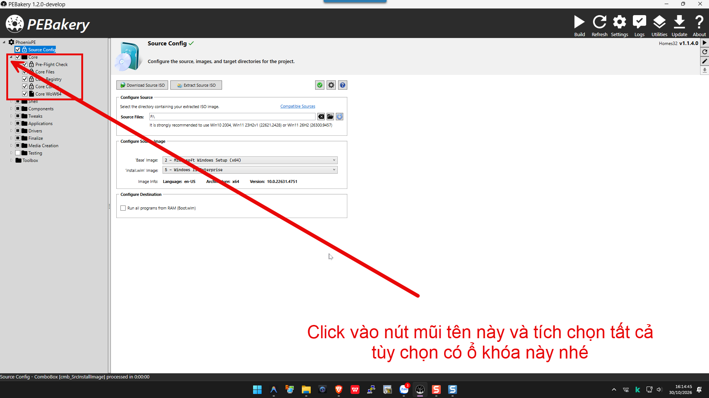

---

### Bước 18: Tinh chỉnh thông số RAM ảo trong Core Config
Nhấp chuột trực tiếp vào mục **`Core Config`**:
- **Numlock Status:** Đặt thành **`ON`** để tự bật bàn phím số khi khởi động máy.
- **WinPE Cache Size:** Chọn mức **`4096` MB** (4 GB RAM ảo).
  > **💡 Lời khuyên:** Cấp phát 4096 MB giúp WinPE hoạt động cực kỳ mượt mà, thoải mái cài đặt driver, giải nén và chạy cùng lúc nhiều phần mềm cứu hộ nặng mà không bị tình trạng tràn bộ nhớ đệm (RAMDisk đầy).

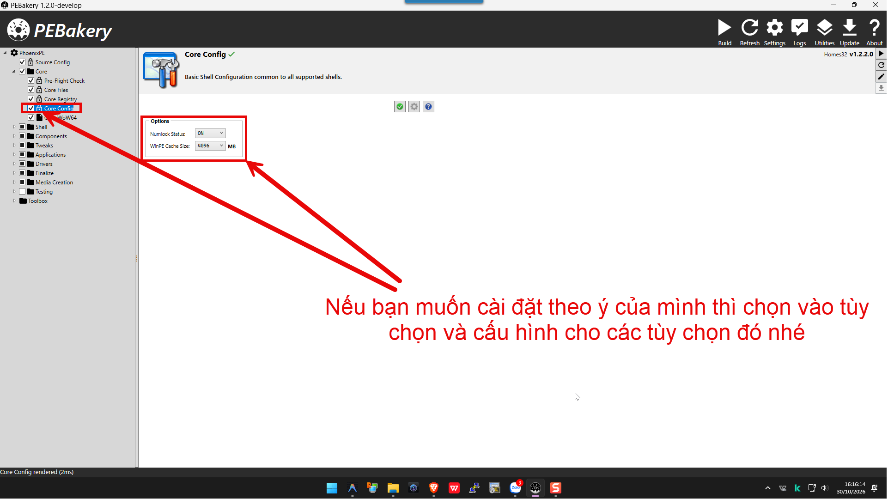

---

## 6. Cấu hình Giao diện người dùng (Shell & StartAllBack)

### Bước 19: Kích hoạt các gói giao diện Shell
Nhấp vào mũi tên mở rộng nhánh **Shell**, tích chọn các mục sau:
- ☑ **PreShell:** Quản lý khởi động các dịch vụ nền và tạo phím tắt.
- ☑ **Explorer Shell:** Môi trường Desktop và trình quản lý tệp tin Windows Explorer quen thuộc.
- ☑ **StartAllBack:** Tùy biến thanh Taskbar và Start Menu theo phong cách Windows 11 hiện đại.

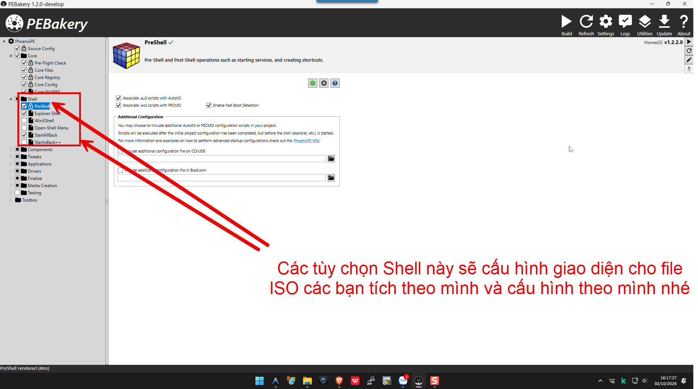

---

### Bước 20: Tinh chỉnh trải nghiệm với Explorer Shell
Nhấp chọn mục **`Explorer Shell`**:
- **Shortcuts (Phím tắt):** Tích chọn `Desktop`, `Start Menu`, `Pin to Taskbar`, `Pin to Start Menu`.
- **Options (Tùy chọn hiển thị):**
  - ☑ `Always show menus`
  - ☑ `Show status bar` (Hiện thanh trạng thái)
  - ☑ `Show hidden files and folders` (Luôn hiển thị file và thư mục ẩn)
  - ☑ `Show computer on desktop` (Hiển thị biểu tượng This PC ngoài Desktop)
  - ☑ `Lock the taskbar` (Khóa thanh taskbar)
  - ☑ `Dynamic transparency/aura/shyness`

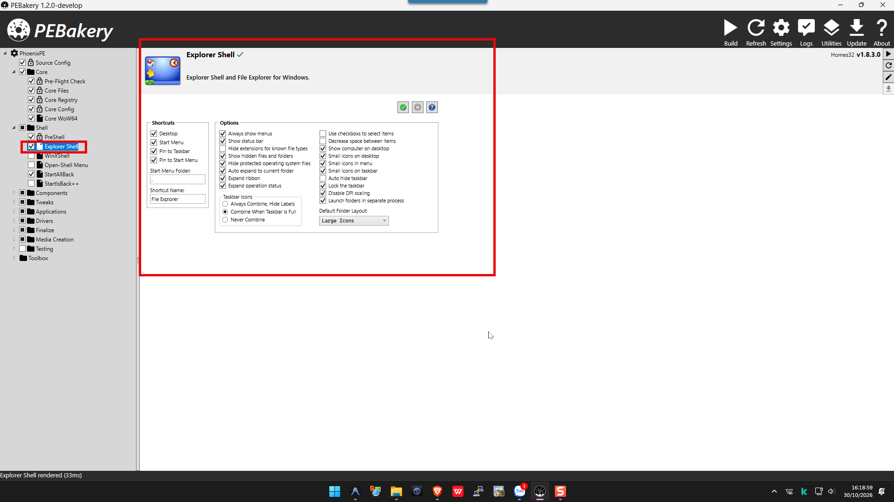

---

### Bước 21: Tùy biến thanh tác vụ Taskbar với StartAllBack
Nhấp chọn mục **`StartAllBack`**:
- **Theme (Giao diện):** Chọn **`Proper 11`**.
- **Taskbar location (Vị trí):** Chọn **`Bottom`** (nằm ở cạnh dưới màn hình).
- **Combine buttons (Gộp nút ứng dụng):** Chọn **`When taskbar is full`** (chỉ gộp khi thanh taskbar đầy để dễ quan sát cửa sổ đang mở).
- Tích chọn **`Dynamic transparency/aura/shyness`** để tạo hiệu ứng trong suốt mờ ảo (Acrylic / Mica) cực kỳ đẹp mắt.

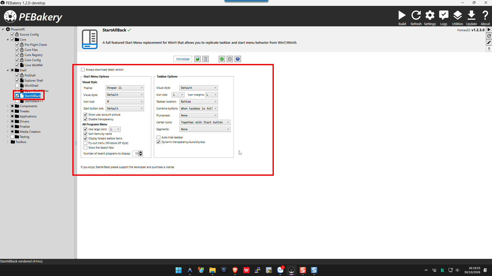

---

## 7. Tích hợp các thành phần hệ thống & Tinh chỉnh (Components & Tweaks)

### Bước 22: Mở rộng nhánh Components và tích chọn tiện ích
Nhấp mở mũi tên mục **`Components`**, tích chọn các gói thư viện quan trọng:
- ☑ **Networking:** Hỗ trợ kết nối mạng.
- ☑ **PENetwork Manager:** Trình điều khiển kết nối mạng tiện dụng ngoài Desktop.
- ☑ **Camera:** Hỗ trợ phần cứng camera/webcam.
- ☑ **.NET Runtime -> .NET 8:** Môi trường chạy các công cụ viết bằng .NET Core / .NET 8 hiện đại.
- ☑ **Visual C++ Runtime -> Visual C++ 14 Runtime:** Bộ thư viện C++ cần thiết cho 99% các phần mềm cứu hộ máy tính.

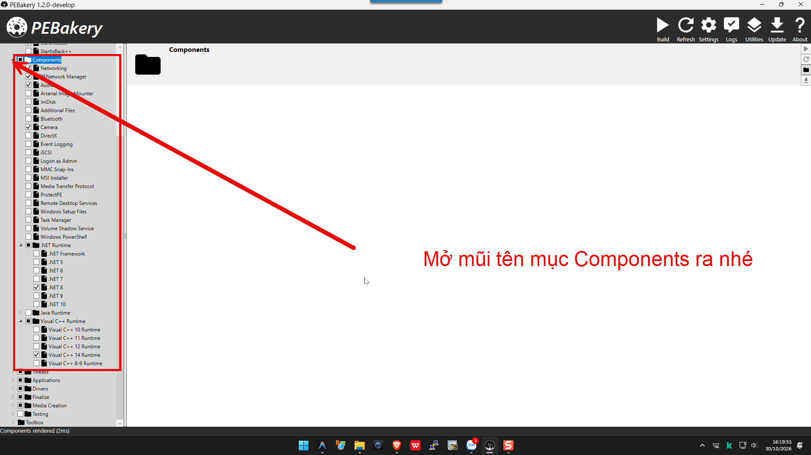

---

### Bước 23: Cấu hình chi tiết tính năng mạng (Networking)
Nhấp chọn mục **`Networking`**:
- Tích chọn: **`Enable the Network List Service`** và **`Enable Network Discovery Services`** (cho phép tự động tìm kiếm máy in và chia sẻ file trong mạng nội bộ).
- Khung **Initialize Network:** Tích chọn `Desktop` và `Start Menu`.
- Khung **Firewall:** Tích chọn `Desktop` và `Start Menu` để dễ dàng bật/tắt tường lửa khi cần truyền dữ liệu.

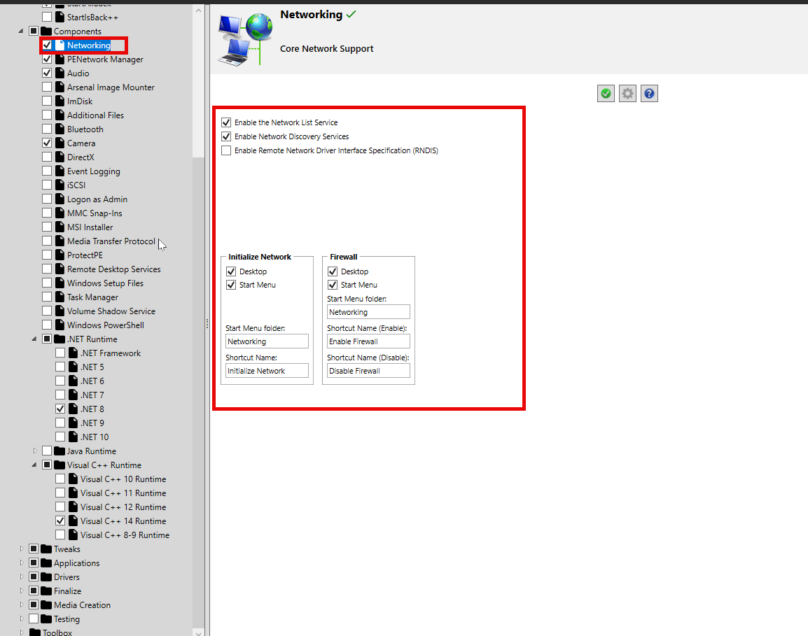

---

### Bước 24: Cấu hình tinh chỉnh hệ thống (Tweaks)
Nhấp vào mũi tên mục **`Tweaks`**, tích chọn các tính năng sau:
- ☑ **Command Prompt:** Khởi chạy cửa sổ dòng lệnh CMD.
- ☑ **Power Options:** Quản lý chế độ nguồn điện (ngăn máy rơi vào trạng thái ngủ khi đang sao lưu cứu hộ).
- ☑ **Visual Effects:** Bật hiệu ứng đồ họa mượt mà.
- ☑ **Wallpaper:** Cài đặt hình nền chuyên nghiệp.
- ☑ **Write Protect Removable Media:** Tính năng bảo vệ chống ghi cho thiết bị di động, ngăn ngừa virus từ máy tính nhiễm độc lây lan sang USB Boot.

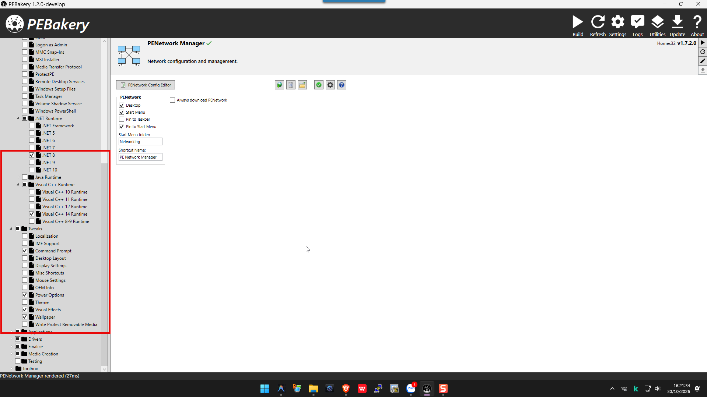

---

## 8. Tích hợp Ứng dụng cứu hộ chuyên dụng (Applications)

### Bước 25: Lựa chọn các phần mềm cứu hộ máy tính
Nhấp vào mũi tên mục **`Applications`** để mở rộng danh sách các ứng dụng cứu hộ được tích hợp sẵn:
- **Backup & Imaging (Sao lưu & Ghost máy):**
  - ☑ `Acronis True Image` / `Acronis True Image 2021` (Sao lưu và phục hồi ảnh phân vùng nổi tiếng).
  - ☑ `Macrium Reflect X` (Công cụ sao lưu đĩa nhanh và chuẩn xác hàng đầu).
- **Benchmarking & Testing (Kiểm tra phần cứng):**
  - ☑ `Prime95` (Kiểm tra độ ổn định của CPU và RAM).
  - ☑ `AIDA64`, `CPU-Z`, `GPU-Z`, `CrystalDiskInfo` (Xem chi tiết thông số phần cứng và sức khỏe ổ cứng).
- **Password Recovery (Xử lý mật khẩu):**
  - ☑ `NTPWEdit` (Công cụ xóa hoặc đổi mật khẩu tài khoản Windows khi bị quên).
- **Disk Management (Quản lý ổ cứng):**
  - ☑ `MiniTool Partition Wizard` (Chia ổ đĩa, chuyển đổi MBR sang GPT không mất dữ liệu).
- **File Management & Recovery (Cứu dữ liệu):**
  - ☑ `7-Zip`, `Recuva`...

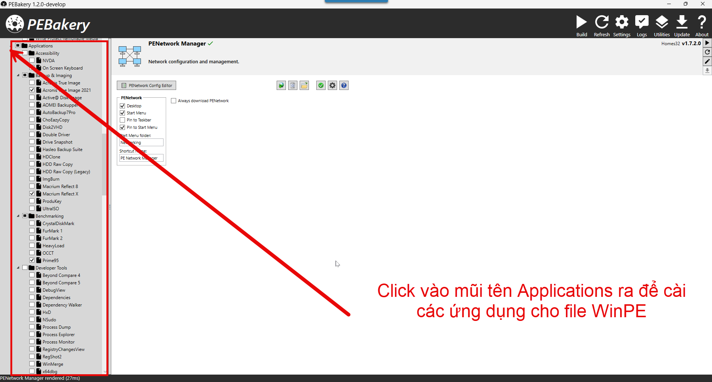

---

## 9. Tích hợp Trình điều khiển phần cứng (Drivers)

> **⚠️ LƯU Ý CỰC KỲ QUAN TRỌNG:** Rất nhiều máy tính hiện đại (dùng vi xử lý Intel Core thế hệ 11, 12, 13, 14 hoặc AMD Ryzen mới) khi vào WinPE thông thường sẽ **không nhìn thấy ổ cứng NVMe** do thiếu driver Intel VMD / RST. Bước này sẽ khắc phục triệt để vấn đề đó!

### Bước 26: Tích chọn các Driver phần cứng thiết yếu
Mở rộng mục **`Drivers`**, tích chọn đầy đủ các mục:
- ☑ **Display Drivers:** Trình điều khiển đồ họa cơ bản giúp nhận đúng độ phân giải màn hình.
- ☑ **Driver Integration:** Hệ thống tự động nạp driver khi WinPE khởi động.
- ☑ **Intel MEI Driver:** Trình điều khiển Intel Management Engine Interface.
- ☑ **Intel RST Driver:** Driver Intel Rapid Storage Technology (Bắt buộc phải có để nhận ổ cứng SSD NVMe chuẩn PCIe Gen 4/Gen 5).
- ☑ **Network Drivers:** Driver mạng có dây (LAN) và không dây (Wi-Fi) phổ biến của Intel, Realtek, Atheros.
- ☑ Mục **Tools -> Driver Injection:** Kích hoạt chức năng bơm driver vào hệ thống.

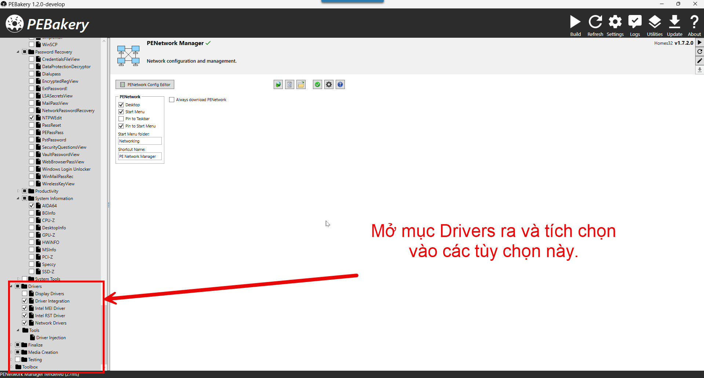

---

## 10. Cấu hình hoàn tất và Thiết lập xuất file ISO (Finalize & Media Creation)

### Bước 27: Cấu hình các bước đóng gói hoàn thiện (Finalize)
Nhấp vào mũi tên mục **`Finalize`**, tích chọn các mục:
- ☑ **Bootmgr:** Trình quản lý khởi động kép tương thích cả chuẩn UEFI (x64) lẫn Legacy BIOS.
- ☑ **SlimFast:** Tự động loại bỏ các tệp rác và nén tối ưu kích thước hệ điều hành WinPE.
- ☑ **Post-Process:** Xử lý hậu kỳ sau khi nén.
- ☑ **Capture Wim:** Đóng gói toàn bộ môi trường vừa tạo thành tệp tin `Boot.wim` hoàn chỉnh.

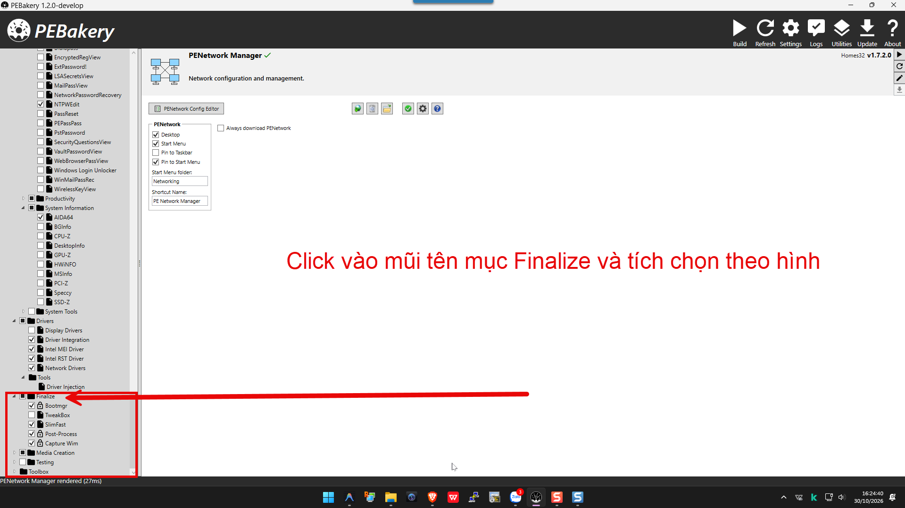

---

### Bước 28: Thiết lập xuất file ISO (Media Creation)
Nhấp vào mũi tên mục **`Media Creation`** và chọn mục con **`Create ISO`**:
- **Create ISO Using:** Chọn công cụ **`oscdimg`** (trình tạo ISO chuẩn của Microsoft hỗ trợ Bootable đa chuẩn).
- **Volume name:** Nhập tên nhãn đĩa ISO theo ý bạn (ví dụ: `LeTheTuanPC` hoặc `WINPE_RESCUE`).
- **File name:** Định dạng tên file xuất xưởng, giữ mặc định `{ProjectTitle}_{SourceLang}_{SourceArch}.iso` hoặc tự đặt tên tùy thích.

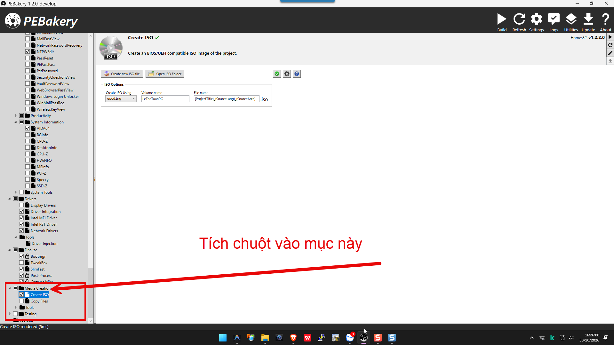

---

## 11. Tiến trình Đóng gói (Build) và Nhận thành phẩm

### Bước 29: Nhấn nút Build để bắt đầu
Kiểm tra lại lần cuối các thiết lập. Khi đã sẵn sàng:
- Nhấp vào nút **Build** (biểu tượng nút Play hình tam giác màu trắng ở góc trên bên phải thanh công cụ của PEBakery).

---

### Bước 30: Quá trình trích xuất và xử lý dữ liệu đang diễn ra
- Phần mềm PEBakery sẽ tự động chạy toàn bộ các kịch bản tuần tự từ 1 đến 46.
- Đầu tiên, chương trình sẽ trích xuất các tệp tin hệ thống từ đĩa nguồn Windows 11 (`Core Files`, `WimExtractBulk Progress`...).
- **Bạn hãy giữ máy tính hoạt động ổn định và chờ phần mềm xử lý tự động.** Quá trình này thông thường mất từ 5 đến 15 phút tùy thuộc vào tốc độ CPU và ổ cứng của bạn.

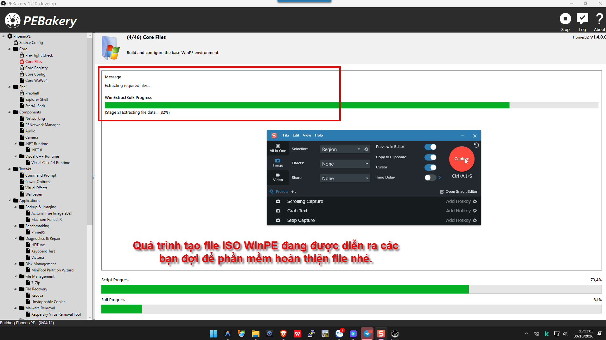

---

### Bước 31: Đóng gói Boot.wim và xuất file ISO thành phẩm
- Khi tiến trình chạy đến bước **(45/46) Capture Wim - Build the final Boot.wim**, thanh tiến trình tổng thể (`Full Progress`) sẽ đạt trên 95%.
- PEBakery tiến hành nén khối dữ liệu hoàn thiện thành file `Boot.wim` và gọi công cụ `oscdimg` để xuất file ISO cứu hộ hoàn chỉnh.

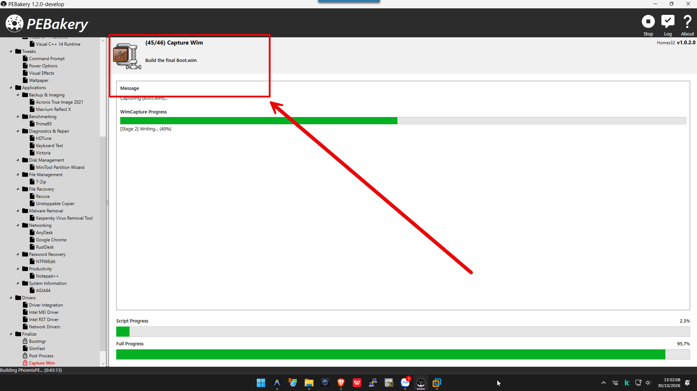

---

### Bước 32: Nhận file ISO thành phẩm
Khi quá trình Build kết thúc thành công:
1. Quay lại màn hình **`Create ISO`** (như ở Hình 30).
2. Nhấn nút **`Open ISO Folder`** để mở ngay thư mục chứa file ISO vừa tạo (thường nằm trong thư mục `Output` của PhoenixPE).
3. Bây giờ bạn đã sở hữu một file ISO WinPE cứu hộ hoàn toàn sạch sẽ, tối ưu và mang đậm dấu ấn cá nhân!

---

## 12. Hướng dẫn tạo USB Boot từ file ISO vừa tạo

Sau khi đã có file ISO, bạn có thể tạo một chiếc USB cứu hộ đa năng theo 1 trong 2 cách sau:

### Cách 1: Sử dụng Ventoy (Khuyên dùng - Tiện lợi nhất)
1. Cài đặt phần mềm **Ventoy** lên USB của bạn (chỉ cần làm 1 lần).
2. Copy trực tiếp file ISO WinPE vừa tạo dán vào USB Ventoy.
3. Cắm USB vào máy tính cần sửa chữa, chọn khởi động từ USB và chọn tên file WinPE để boot ngay!

### Cách 2: Sử dụng Rufus
1. Tải phần mềm **Rufus** bản mới nhất.
2. Cắm USB (dung lượng từ 4GB trở lên).
3. Tại mục **Boot selection**, nhấn **SELECT** và trỏ đến file ISO WinPE.
4. Mục **Partition scheme**, chọn **GPT** (dành cho chuẩn UEFI) hoặc **MBR** (tương thích cả máy cũ).
5. Nhấn **START** và chờ Rufus ghi dữ liệu lên USB hoàn tất.

---

Chúc bạn thực hiện thành công và sở hữu một chiếc USB cứu hộ máy tính thật chuyên nghiệp và đắc lực! 🚀
